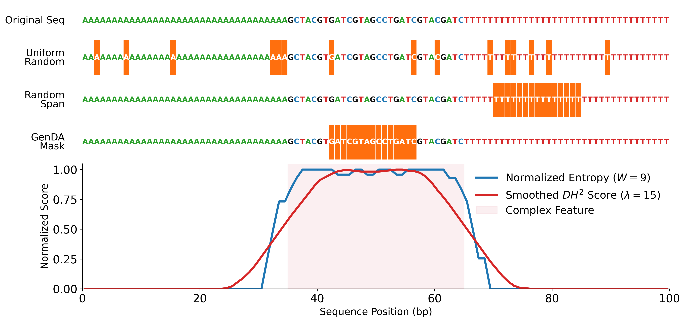

# GenDA: When Genomic Masking Priors Fail to Transfer: Strong Variant Prediction, Weak Functional Generation

[](https://arxiv.org/abs/2609.04861) [](https://github.com/susuhu/GenDA)


GenDA is a bidirectional discrete diffusion model for genomic DNA that uses entropy-guided
span masking. This repository provides its training and generation implementation for
research into the capabilities and limitations of genomic diffusion models.


The study reports mixed results:

- **Variant prediction:** after supervised fine-tuning, the 202M-parameter GenDA model
  achieves a pooled ClinVar SNV AUROC of **0.774**, exceeding a similarly sized
  autoregressive model by **0.103**.
- **Masking ablation:** a matched random-span model achieves **0.777**, so these results
  do not establish an advantage from entropy-guided masking for ClinVar prediction.
- **Functional generation:** in zero-shot inpainting across promoters, enhancers, exon
  boundaries, and intron boundaries, GenDA does not consistently outperform a native-gap
  shuffle control that preserves 3-mer composition. Failures occur even for 50–500 bp gaps.

These findings distinguish supervised variant prediction from functional sequence
restoration. Generated DNA should not be interpreted as functionally validated on the
basis of this model's prediction performance.

This package includes human-genome pretraining, checkpoint loading, and conditional
DNA generation with ModernBERT and Llama backbones. The paper's supervised variant-prediction
and functional-inpainting evaluation workflows are not included in the current package.



## 1. Install

Obtain this repository and open its root directory. All commands below run from that directory.
Python 3.10 or newer is required; the CPU smoke tests used Python 3.10, PyTorch 2.12.1,
and Transformers 5.12.1. No existing DLM checkout or private environment is required.

```bash
python3 -m venv .venv
source .venv/bin/activate
python -m pip install --upgrade pip
```

Install PyTorch for your hardware using the [official installation selector](https://pytorch.org/get-started/locally/),
then install GenDA and the Transformers version used for verification:

```bash
python -m pip install -e . 'transformers==5.12.1'
python train.py --help
python predict.py --help
```

The supplied model config selects `flash_attention_2`. To use it, install Flash Attention
in a compatible CUDA/PyTorch environment following its [installation instructions](https://github.com/Dao-AILab/flash-attention#installation-and-features).
Alternatively, pass `--attention sdpa` during training and generation. Full-size training
requires substantial accelerator and host memory; the data pipeline loads the reference
genome into RAM for each dataset instance. CPU execution is useful for the small tests.

Optional experiment tracking: `python -m pip install -e '.[tracking]'`, then train with
`--wandb`. Tracking is disabled by default.

## 2. Download the reference data

The reference sources and enhancer filtering below preserve the DLM README's data setup.
Use the **hg38 / GRCh38** assembly consistently.

| Resource | Source | Local filename | Used by |
| --- | --- | --- | --- |
| Genome FASTA | [UCSC hg38](https://hgdownload.soe.ucsc.edu/goldenPath/hg38/bigZips/) | `hg38.fa` | Training |
| Gene annotations | [GENCODE human release 49](https://www.gencodegenes.org/human/release_49.html) | `gencode.v49.annotation.gtf` | Training |
| Repeat annotations | [UCSC RepeatMasker](https://hgdownload.soe.ucsc.edu/goldenPath/hg38/bigZips/hg38.fa.out.gz) | `hg38.fa.out` | Training |
| Enhancer annotations | [ENCODE cCREs V3](https://downloads.wenglab.org/V3/GRCh38-cCREs.bed) | `hg38_enhancers_only.bed` | Training |

The commands require `wget`, `gzip`, and `awk`. Downloads are large; choose a location with
space for compressed files, extracted references, and generated anchor CSVs.

```bash
mkdir -p data/reference

# hg38 reference genome
wget -c -P data/reference https://hgdownload.soe.ucsc.edu/goldenPath/hg38/bigZips/hg38.fa.gz
gzip -dc data/reference/hg38.fa.gz > data/reference/hg38.fa

# GENCODE v49 comprehensive gene annotation on reference chromosomes
wget -c -P data/reference https://ftp.ebi.ac.uk/pub/databases/gencode/Gencode_human/release_49/gencode.v49.annotation.gtf.gz
gzip -dc data/reference/gencode.v49.annotation.gtf.gz > data/reference/gencode.v49.annotation.gtf

# RepeatMasker annotations for training
wget -c -P data/reference https://hgdownload.soe.ucsc.edu/goldenPath/hg38/bigZips/hg38.fa.out.gz
gzip -dc data/reference/hg38.fa.out.gz > data/reference/hg38.fa.out

# ENCODE cCRE V3: retain distal and proximal enhancer-like signatures
wget -c -P data/reference https://downloads.wenglab.org/V3/GRCh38-cCREs.bed
awk '/dELS|pELS/' data/reference/GRCh38-cCREs.bed > data/reference/hg38_enhancers_only.bed
test -s data/reference/hg38_enhancers_only.bed
```

The enhancer filter retains the same `dELS|pELS` rows as the original instructions.
Keep chromosome names such as `chr1` consistent between the FASTA and annotations.
The parsers skip annotations whose chromosome is absent from the FASTA. FASTA indexing
is handled by `pyfaidx` on first access, so the reference directory must be writable then.

## 3. Configure paths and prepare data

`configs/config_GenDA.yaml` contains the supplied model and training settings with portable
paths matching the download commands:

```yaml
fasta_path: data/reference/hg38.fa
gtf_path: data/reference/gencode.v49.annotation.gtf
repeatmasker_path: data/reference/hg38.fa.out
ccre_bed_path: data/reference/hg38_enhancers_only.bed
```

Relative paths resolve from the working directory. If your references are elsewhere, copy
the config and edit these four paths, then pass your copy using `--config` in every command.
ClinVar evaluation is disabled by default; its parquet file is unnecessary for this workflow.

GenDA uses one data pipeline with promoter, exon, intron, repeat, and enhancer anchors.
Prepare the data before training:

```bash
python -m genda.data.prepare --config configs/config_GenDA.yaml \
  --output-dir data/cache
```

This writes `train_set.csv`, `val_set_fixed.csv`, and `test_set_fixed.csv` plus
parsed-anchor caches. Training also prepares missing caches automatically. Existing
caches are reused; choose a new cache directory when changing reference files or the split seed.

### Reproduce an existing experiment

Use the exact train/validation/test CSVs from that experiment. Rebuilding splits from
raw annotations and a seed alone is not a substitute for preserving the original files.
Place all three files in one directory, for example `data/splits/published`, and pass
that directory with `--cache-dir`:

```bash
python train.py --config configs/config_GenDA.yaml --output-dir runs \
  --cache-dir data/splits/published
```

When all three files exist, the pipeline loads them directly and rebuilds the background
exclusion intervals from their combined anchors. The `all_anchors_*.csv` intermediate
caches are not required for that path. Keep the split CSV contents and row order unchanged.
Genome sequence and annotation downloads are still described above; anchor CSVs do not
contain the genome sequence.

For a reproducible release, distribute the three split files as a versioned compressed
archive and record their SHA-256 hashes, row counts, reference assembly and annotation
versions, preparation code revision, seed, and training config. Reference-file hashes
also help identify the exact source data. Link the archive from the release documentation;
no published split-download URL is configured in this repository yet. Splits preserve
anchor membership, while training still samples windows and background sequences dynamically.

## 4. Train

```bash
# Training on one device
python train.py --config configs/config_GenDA.yaml --output-dir runs \
  --cache-dir data/cache

# Training on four GPUs
torchrun --nproc_per_node=4 train.py --config configs/config_GenDA.yaml \
  --output-dir runs --cache-dir data/cache
```

Append `--attention sdpa` if Flash Attention is not installed. Adjust `batch_size` to your
hardware; it is the per-process batch size. `accumulation_steps` controls gradient accumulation.
`--workers 0` is supported. The example settings are a full training configuration, not a
small hardware check; use the tests below for a CPU smoke run.

Each run directory contains `run_config.yaml`, `run_arguments.yaml`, `last_model.pt`,
periodic checkpoints, and `best_model.pt` after validation. Training is controlled by
`total_steps` (optimizer updates); `epochs` is retained but unused by this step-based loop.
`patience` counts validation checks. The final test evaluates the best checkpoint when available.

To resume, replace `runs/RUN` with your actual run directory:

```bash
python train.py --config configs/config_GenDA.yaml --output-dir runs \
  --cache-dir data/cache \
  --resume-from runs/RUN/last_model.pt --continue-training
```

Resume restores weights, optimizer, scheduler, and global step. The checkpoint's
`run_config.yaml` supplies the architecture; `total_steps` and `patience` may be updated
from `--config`. Reuse the original split cache directory. RNG/iterator state
and the early-stopping counter are not restored, so resume is not bitwise identical to an
uninterrupted run. Omit `--continue-training` to load weights with a fresh optimizer and
schedule using the checkpoint's saved configuration.

## 5. Generate DNA

Training produces the checkpoint needed for generation. If you receive a compatible
checkpoint separately, keep its matching `run_config.yaml` alongside it. No pretrained
weights are included in this repository; generation does not require the reference data.

```bash
python predict.py --checkpoint runs/RUN/best_model.pt --output-dir outputs/example \
  --prompt '[HUMAN][PROMOTER]' --samples 4 --batch-size 2 --length 256 --steps 32
```

Outputs are `sequences.fasta`, `sequences.csv`, and `generation.json`. Use a new output
directory for each invocation to retain previous results. `--config PATH` can specify a
checkpoint config stored elsewhere. CPU inference automatically uses SDPA.

Options include classifier-free guidance (`--cfg-scale`), variable-length generation
(`--allow-eos`), optional biological heuristics (`--bio-check`), and
`--remasking-strategy poisson_span`. Heuristics are disabled by default. Prompt conditions
should correspond to those represented in the checkpoint's training data.

Lengths count generated tokens: one token is one base with the supplied 1-mer tokenizer.
The 4096-token context includes prompts and BOS/EOS, leaving at most 4092 generated tokens
for a two-token prompt. All prompts in a batch and the negative prompt must have equal token
lengths. This interface generates an appended masked region; internal-gap inpainting and
variant-effect benchmark scripts are outside this package's current CLI scope.

```python
from genda.inference.api import Predictor

predictor = Predictor("runs/RUN/best_model.pt")
dna = predictor.generate("[HUMAN][EXON]", length=256, steps=32)
```

## Tests and code layout

```bash
python -m unittest discover -s tests -v
```

The tests use a tiny synthetic genome and model; they require no reference downloads or GPU.

| Directory | Contents |
| --- | --- |
| `genda/model/` | Backbones and shared model factory |
| `genda/data/` | Tokenizer, masking, genome parsing, data preparation, loaders |
| `genda/training/` | Training CLI, loop, optional tracking and ClinVar evaluation |
| `genda/inference/` | Diffusion sampler, prediction API and CLI |
| `configs/` | Model, training, and data configuration |
| `tests/` | CPU regression checks |

Current-source DLM checkpoints retain their parameter names and vocabulary IDs. Checkpoints
with incompatible architectures or vocabulary sizes raise an error rather than loading
partial weights. Validation coverage and extraction provenance are recorded separately in
[developer documentation](docs/development/README.md); those files are not needed to use GenDA.


## Citation

If you find our work useful, please consider citing us:

```bibtex
@article{hu2026genomic,
  title={When Genomic Masking Priors Fail to Transfer: Strong Variant Prediction, Weak Functional Generation},
  author={Hu, Susu and Gattogi, Preetam and Lehmann, Jens and Vahdati, Sahar and Speidel, Stefanie and Vibert, Julien},
  journal={arXiv preprint arXiv:2609.04861},
  year={2026}
}
```
